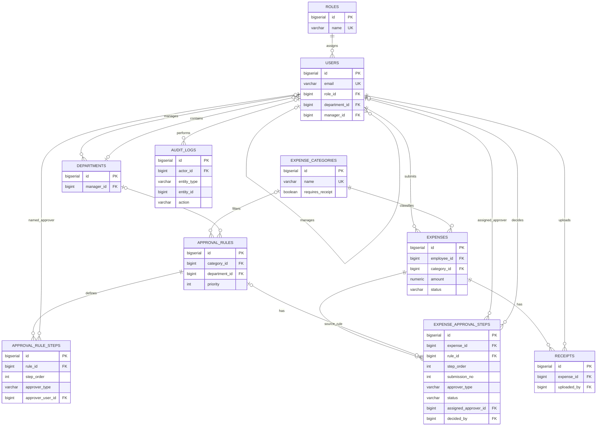

# Expense Management System

Employees submit expenses with receipts. A manager approves every expense first. Configurable rules may add further approvers. Finance exports the approved expenses.

**Stack:** Java 21, Spring Boot, Maven, PostgreSQL. One application. All amounts are INR.

---

## A. Problem-Solving Approach

### Modules

| Module | Responsibility |
|---|---|
| Identity and Access | Authentication, one role per user, and access checks |
| Master Data | Departments, categories, users, and approval rules |
| Expenses | Drafts, validation, submission, and receipts |
| Approval | Mandatory manager step, then any extra steps from the matched rule |
| Finance | Filter approved expenses and export CSV |
| Audit | Record submission, decisions, resubmission, rule changes, and exports |

### Architecture

One Spring Boot application uses a modular monolith with the usual layers. PostgreSQL stores the data. The existing `com.company.expense` packages are the module layout.

| Layer | Responsibility |
|---|---|
| Controller | HTTP requests and responses |
| Service | Business rules and workflow |
| Repository | Database access |
| Entity | Persistent data |
| DTO | API request and response bodies |
| Security | Authentication and authorization |
| Configuration | Application and file-storage settings |
| Exception | Consistent API errors |

**Manager:** Use `users.manager_id`. If it is null, use `departments.manager_id`. Submission is blocked unless that user is an active Manager, belongs to the same department, and is not the employee.

**Receipts:** Store files on the local filesystem and keep only metadata in PostgreSQL. Keep file storage separate from expense logic so it can move to object storage later.

### Workflow

**Expense status:** `DRAFT`, `SUBMITTED`, `APPROVED`, `REJECTED`.

1. The employee creates a draft with date, amount, currency code, category, and description.
2. The employee uploads receipts. A receipt is required when the category says so.
3. Submit validates the expense and required receipts, then sets `SUBMITTED`.
4. The system resolves the manager. If none is valid, submission is blocked.
5. It creates the manager step first, selects one approval rule, and appends that rule's steps.
6. Approvers act on one step at a time and may leave a comment.
7. When every step is approved, the expense becomes `APPROVED`.
8. A rejection sets the expense to `REJECTED` and marks the remaining steps `SKIPPED`.
9. The employee can edit a rejected expense while it stays `REJECTED`, then resubmit. Resubmission repeats validation and step generation, sets `SUBMITTED`, updates `submitted_at`, and stores new steps under the next `submission_no`. Older steps remain.

Every generated step starts as `PENDING`. The actionable step is the lowest `step_order` still `PENDING` on the latest `submission_no`. Queues show only that step.

Steps are copied at submission. Later edits to rules do not change an expense that has already been submitted.

Finance lists and exports `APPROVED` expenses. A Finance user approves an expense only when a rule adds a Finance step.

### Approval rules

Rules add steps after the mandatory manager approval. They are not used to configure that first step.

A rule matches only when every set condition matches:

- **Category:** one category, or all when empty.
- **Department:** one department, or all when empty.
- **Amount:** inclusive range in INR. An empty maximum means no upper limit.

If several active rules match, the lowest `priority` wins. Active priorities are unique. If none match, manager approval is enough.

Extra steps use one of these approver types:

- `FINANCE_ROLE` — any active Finance user, once the step is actionable. The user who decides is stored on the step.
- `SPECIFIC_USER` — one active Manager or Finance user. The expense owner cannot be selected.

| Rule | Conditions | Extra steps |
|---|---|---|
| Large Spend | Minimum 500.01, no maximum | Finance role |
| Travel Expenses | Category = Travel | One named user |
| Department Spend | Department = Sales, amount 1,000–5,000 | Finance role |

These values are examples. An active rule must have at least one step. An inactive rule may be saved before its steps exist.

### Receipts and finance export

- Accepted files: PDF (`application/pdf`), JPEG (`image/jpeg`), and PNG (`image/png`). Maximum size: 5 MB each.
- The employee can download receipts on their own expenses.
- Current and past approvers can download receipts for expenses they were assigned or have decided.
- Finance can download receipts for approved expenses.
- Administrators cannot download receipt files.

Finance can filter approved expenses by date range, department, category, and employee, see the total, and export CSV with:

`expense_id`, `employee`, `department`, `category`, `expense_date`, `amount`, `currency_code`, `status`, `submitted_at`.

### Build order

| Milestone | Focus | Done when |
|---|---|---|
| 1. Foundation | Spring Boot, PostgreSQL, Flyway, login, and roles | An admin and an employee can sign in |
| 2. Master data | Departments, categories, users, direct managers, and department managers | An admin can maintain them |
| 3. Submission | Drafts, receipt upload, validation, and submit | An employee can submit an expense with a required receipt |
| 4. Rules | Manager step, rule matching, and extra steps | Submit creates the correct steps |
| 5. Decisions | Approve, reject, and resubmit | Assigned approvers can decide, and a rejected expense can be resubmitted |
| 6. Finance and audit | Approved list, filters, total, CSV, and audit log | Finance can export a filtered report |

Add Flyway migrations with each milestone, in this order: identity, master data, expenses and receipts, rules, approval steps, audit. Do not add empty migrations in advance.

---

## B. Roles and Responsibilities

Each user has one role: Employee, Manager, Finance, or Administrator. A Manager can submit personal expenses. That does not require a second role and does not expose other employees' drafts.

| Role | Responsibility | Scope |
|---|---|---|
| Employee | Record and track own expenses | Own expenses and receipts |
| Manager | Decide assigned steps and submit own expenses | Assigned steps and own expenses |
| Finance | Export approved expenses and decide Finance steps | Approved expenses and actionable Finance steps |
| Administrator | Maintain users, departments, categories, and rules; read the audit log | Configuration and audit records |

### Role-permission matrix

| Operation | Employee | Manager | Finance | Admin |
|---|---|---|---|---|
| Sign in | Yes | Yes | Yes | Yes |
| Create or edit own draft | Yes | Own only | No | No |
| Submit or resubmit own expense | Yes | Own only | No | No |
| Upload or view own receipt | Yes | Own only | No | No |
| View assigned approval queue | No | Yes | Only if assigned | No |
| Approve or reject the current step | No | Only if assigned | Only if assigned | No |
| View receipts on assigned or reviewed expenses | No | Yes | Yes | No |
| View receipts on approved expenses | No | No | Yes | No |
| List and export approved expenses | No | No | Yes | No |
| Manage users, departments, categories, and rules | No | No | No | Yes |
| View the audit log | No | No | No | Yes |

A user cannot approve their own expense. Finance and Admin users cannot create expenses.

---

## C. Database Schema

PostgreSQL. Use `BIGSERIAL` primary keys, `TIMESTAMPTZ` timestamps, `NUMERIC(12,2)` money, and `VARCHAR` values guarded by `CHECK` constraints. Foreign keys block deletion of a user, department, or category that is still referenced. Deactivate an approval rule that already appears on an expense; do not delete it.

`currency_code` stays on the expense for later use. The MVP accepts only `INR`.

### `roles`

Seed these names in the first migration. Administrators assign them and cannot add new ones.

| Column | Type | Notes |
|---|---|---|
| `id` | `BIGSERIAL` | Primary key |
| `name` | `VARCHAR(50)` | Unique, not null. `EMPLOYEE`, `MANAGER`, `FINANCE`, `ADMIN` |
| `description` | `VARCHAR(255)` | Optional |

### `departments`

| Column | Type | Notes |
|---|---|---|
| `id` | `BIGSERIAL` | Primary key |
| `name` | `VARCHAR(100)` | Unique, not null |
| `code` | `VARCHAR(20)` | Unique, not null |
| `manager_id` | `BIGINT` | Nullable foreign key to `users.id` |
| `active` | `BOOLEAN` | Not null, default `true` |

`manager_id` and `users.department_id` point at each other, so both stay nullable. Create the department, add users, then set the department manager. The manager must be an active Manager in that department. Employees with no direct manager cannot submit until this manager exists.

### `users`

| Column | Type | Notes |
|---|---|---|
| `id` | `BIGSERIAL` | Primary key |
| `email` | `VARCHAR(255)` | Unique, not null |
| `password_hash` | `VARCHAR(255)` | Not null |
| `full_name` | `VARCHAR(150)` | Not null |
| `role_id` | `BIGINT` | Not null, foreign key to `roles.id` |
| `department_id` | `BIGINT` | Nullable foreign key to `departments.id`. Required for employees and managers |
| `manager_id` | `BIGINT` | Nullable foreign key to `users.id`. Not equal to `id` |
| `active` | `BOOLEAN` | Not null, default `true` |
| `created_at` | `TIMESTAMPTZ` | Not null |
| `updated_at` | `TIMESTAMPTZ` | Not null |

Only Employee and Manager users can be the `employee_id` on an expense. A direct manager must be an active Manager in the same department.

When a manager becomes inactive, reassign that manager's direct reports in one transaction. Use their department manager. If that person is also unavailable, an administrator assigns another active Manager first.

### `expense_categories`

| Column | Type | Notes |
|---|---|---|
| `id` | `BIGSERIAL` | Primary key |
| `name` | `VARCHAR(100)` | Unique, not null |
| `description` | `VARCHAR(255)` | Optional |
| `requires_receipt` | `BOOLEAN` | Not null, default `true` |
| `active` | `BOOLEAN` | Not null, default `true` |

Inactive categories cannot be selected for a new submission.

### `expenses`

| Column | Type | Notes |
|---|---|---|
| `id` | `BIGSERIAL` | Primary key |
| `employee_id` | `BIGINT` | Not null, foreign key to `users.id` |
| `category_id` | `BIGINT` | Not null, foreign key to `expense_categories.id` |
| `amount` | `NUMERIC(12,2)` | Not null, check `amount > 0` |
| `currency_code` | `CHAR(3)` | Not null, default `INR`, check `currency_code = 'INR'` |
| `expense_date` | `DATE` | Not null |
| `description` | `VARCHAR(500)` | Not null |
| `status` | `VARCHAR(20)` | Not null. `DRAFT`, `SUBMITTED`, `APPROVED`, `REJECTED` |
| `submitted_at` | `TIMESTAMPTZ` | Set on submit and resubmit |
| `created_at` | `TIMESTAMPTZ` | Not null |
| `updated_at` | `TIMESTAMPTZ` | Not null |

`status` is the expense lifecycle. Each decision is stored in `expense_approval_steps`.

### `receipts`

The file is stored on disk. This table stores its metadata.

| Column | Type | Notes |
|---|---|---|
| `id` | `BIGSERIAL` | Primary key |
| `expense_id` | `BIGINT` | Not null, foreign key to `expenses.id` |
| `file_name` | `VARCHAR(255)` | Not null. Original name |
| `content_type` | `VARCHAR(100)` | Not null |
| `storage_path` | `VARCHAR(500)` | Not null |
| `file_size_bytes` | `BIGINT` | Not null, check `file_size_bytes > 0` |
| `uploaded_by` | `BIGINT` | Not null, foreign key to `users.id` |
| `uploaded_at` | `TIMESTAMPTZ` | Not null |

### `approval_rules`

An empty `category_id` or `department_id` means all categories or all departments.

| Column | Type | Notes |
|---|---|---|
| `id` | `BIGSERIAL` | Primary key |
| `name` | `VARCHAR(150)` | Not null |
| `category_id` | `BIGINT` | Nullable foreign key to `expense_categories.id` |
| `department_id` | `BIGINT` | Nullable foreign key to `departments.id` |
| `min_amount` | `NUMERIC(12,2)` | Not null, default `0`, check `min_amount >= 0` |
| `max_amount` | `NUMERIC(12,2)` | Nullable. When set, `max_amount >= min_amount` |
| `priority` | `INTEGER` | Not null. Lower number wins |
| `active` | `BOOLEAN` | Not null, default `true` |
| `created_at` | `TIMESTAMPTZ` | Not null |
| `updated_at` | `TIMESTAMPTZ` | Not null |

Partial unique index on `priority` where `active` is true.

### `approval_rule_steps`

Extra steps only. The manager step is not stored here.

| Column | Type | Notes |
|---|---|---|
| `id` | `BIGSERIAL` | Primary key |
| `rule_id` | `BIGINT` | Not null, foreign key to `approval_rules.id` |
| `step_order` | `INTEGER` | Not null, check `step_order >= 1`. Unique with `rule_id` |
| `approver_type` | `VARCHAR(30)` | Not null. `FINANCE_ROLE` or `SPECIFIC_USER` |
| `approver_user_id` | `BIGINT` | Foreign key to `users.id`. Required for `SPECIFIC_USER`, null for `FINANCE_ROLE` |

### `expense_approval_steps`

A copy of the workflow at submit time. The manager step is `step_order` 1 with `rule_id` null. Copied rule steps keep their order and continue from 2.

| Column | Type | Notes |
|---|---|---|
| `id` | `BIGSERIAL` | Primary key |
| `expense_id` | `BIGINT` | Not null, foreign key to `expenses.id` |
| `rule_id` | `BIGINT` | Nullable foreign key to `approval_rules.id` |
| `step_order` | `INTEGER` | Not null. Unique with `expense_id` and `submission_no` |
| `approver_type` | `VARCHAR(30)` | Not null. `MANAGER`, `FINANCE_ROLE`, or `SPECIFIC_USER` |
| `assigned_approver_id` | `BIGINT` | Foreign key to `users.id`. Set for `MANAGER` and `SPECIFIC_USER`. Null for the shared Finance queue |
| `status` | `VARCHAR(20)` | Not null. `PENDING`, `APPROVED`, `REJECTED`, `SKIPPED` |
| `decision_comment` | `VARCHAR(500)` | Optional |
| `decided_by` | `BIGINT` | Nullable foreign key to `users.id` |
| `decided_at` | `TIMESTAMPTZ` | Nullable |
| `submission_no` | `INTEGER` | Not null, default `1`. Increases on resubmit |

### `audit_logs`

| Column | Type | Notes |
|---|---|---|
| `id` | `BIGSERIAL` | Primary key |
| `actor_id` | `BIGINT` | Nullable foreign key to `users.id` |
| `entity_type` | `VARCHAR(50)` | Not null. Examples: `EXPENSE`, `APPROVAL_RULE`, `USER` |
| `entity_id` | `BIGINT` | Not null. Not a foreign key, because the row can refer to more than one table |
| `action` | `VARCHAR(50)` | Not null. Examples: `SUBMIT`, `APPROVE`, `REJECT`, `RESUBMIT`, `EXPORT` |
| `details` | `JSONB` | Optional |
| `created_at` | `TIMESTAMPTZ` | Not null |

### Application rules

The database cannot check these cleanly across tables:

- The resolved manager is an active Manager in the same department and is not the employee.
- A specific approver is an active Manager or Finance user and is not the expense owner.
- The assigned approver is active when the step is created.
- An employee or manager can submit only when a valid approver exists.
- Only the actionable step can be decided, and nobody can approve their own expense.

### Indexes

- `users(manager_id)`
- `users(department_id, active)`
- `expenses(employee_id, status)`
- `expenses(status, expense_date)`
- `receipts(expense_id)`
- `approval_rule_steps(rule_id, step_order)`
- `expense_approval_steps(assigned_approver_id, status)`
- `expense_approval_steps(approver_type, status)`
- `audit_logs(entity_type, entity_id)`

### ER diagram

Column details are in the tables above. This diagram shows how the tables connect.

---

## D. MVP Limitations

- **Roles:** One predefined role per user. No custom or multiple roles. Finance and Admin cannot submit expenses.
- **Approval:** Sequential only. Manager approval is always first. No parallel approval, delegation, or automatic replacement of an inactive approver.
- **Expenses:** INR only. No currency conversion or budget checks.
- **Receipts:** Local PDF, JPEG, and PNG files up to 5 MB. No OCR.
- **Integrations:** No email, mobile app, payments, or accounting system.
- **Reporting:** Filtered approved-expense list, total, and CSV only.
- **Deployment:** One application and one database. No high-availability setup.

Later versions may add multiple roles, richer approval flows, other currencies, cloud file storage, notifications, external integrations, and broader reporting.
