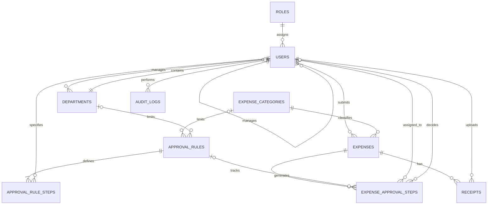
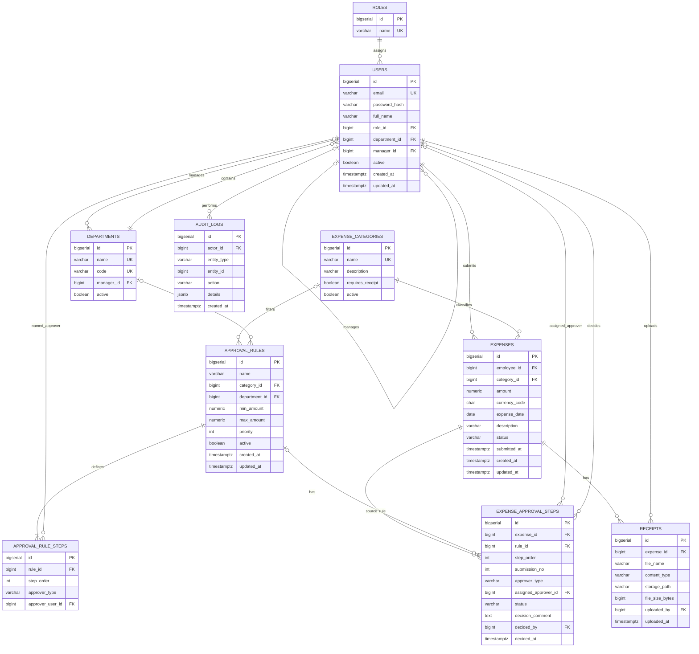

## A. Problem-Solving Approach

### Understanding and Problem Decomposition

The Expense Management System is designed to manage the complete lifecycle of employee expense claims, from submission to approval and financial reporting.

The core business workflow consists of four stages:

1. **Expense Submission:** Employees create expense claims by providing expense details and attaching supporting receipts.
2. **Manager Approval:** Every submitted expense first goes to the employee's direct or team manager for review.
3. **Additional Approval Processing:** Based on configurable business rules, the system determines whether additional approval steps are required. These rules may consider expense amount, department, category or other configured conditions.
4. **Finance Reporting:** Once all required approvals are completed, finance personnel can review approved expenses, apply filters and export reports.

To keep the implementation manageable, the system is divided into the following functional modules:

| Module | Responsibility |
|---|---|
| Identity and Access Management | User authentication, roles and access control |
| Master Data Management | Departments, expense categories and approval configurations |
| Expense Management | Expense creation, validation, submission and receipt handling |
| Approval Workflow | Manager approval, configurable rule evaluation and additional approval decisions |
| Finance and Reporting | Filtering approved expenses and exporting reports |
| Audit Management | Recording important actions and approval decisions |

The initial implementation will focus on establishing a working end-to-end expense submission and approval workflow, followed by finance reporting.

### Proposed Architecture and Modules

The application will follow a **Modular Monolith architecture with layered separation of responsibilities**.

A single Spring Boot application will handle all business operations and use PostgreSQL as its relational database. The system will be organized into logical modules to maintain separation of concerns without introducing the operational complexity of microservices.

The main functional modules are Identity and Access Management, Master Data Management, Expense Management, Approval Workflow, Finance and Reporting, and Audit Management.

Within the application, responsibilities will be separated into the following layers:

| Layer | Responsibility |
|---|---|
| Controller | Handles HTTP requests and responses |
| Service | Implements business rules and coordinates application workflows |
| Repository | Handles database access and persistence |
| Entity | Represents persistent application data |
| DTO | Defines API request and response structures |
| Security | Handles authentication and authorization |
| Configuration | Manages application and infrastructure configuration |
| Exception | Provides consistent error handling |

The existing project package structure will be used to organize these responsibilities. Additional packages will be introduced only when required.

**Manager Identification:** The employee's direct reporting manager will be identified through the `manager_id` relationship in the users table. If no direct manager is assigned, the system will use the manager designated for the employee's department. If neither is available, expense submission will be blocked until a manager is assigned.

**Receipt Storage:** For the MVP, receipt files will be stored on the local filesystem, while their metadata and storage references will be maintained in PostgreSQL. File storage operations should remain separated from the expense business logic to allow migration to object storage in the future.

### Expense Submission and Approval Workflow

The expense submission and approval process will follow a sequential workflow.

**Expense Statuses:** `DRAFT`, `SUBMITTED`, `APPROVED`, `REJECTED`.

1. **Create Draft:** The employee creates an expense with the expense date, amount, currency code, category and description.
2. **Upload Receipts:** The employee uploads one or more supporting receipts. A receipt is mandatory if the selected expense category requires one.
3. **Submit Expense:** Before submission, the system validates the expense details and required receipts. If validation succeeds, the expense status changes to `SUBMITTED`.
4. **Identify First Approver:** The system identifies the employee's direct reporting manager. If no direct manager is assigned, it uses the manager designated for the employee's department. If neither is available, submission is blocked.
5. **Generate Approval Steps:** The system creates the mandatory manager approval step first. It then evaluates the applicable active approval rule and adds any additional approval steps required by that rule.
6. **Process Approvals:** Approval steps are processed sequentially. Only the current pending step can be acted upon. The assigned approver can approve or reject the expense and optionally provide a comment.
7. **Complete Approval:** When all required approval steps are approved, the expense status changes to `APPROVED`.
8. **Handle Rejection:** If any approver rejects the expense, its status changes to `REJECTED`, and all remaining pending approval steps are marked as `SKIPPED`.
9. **Resubmission:** An employee can edit and resubmit a rejected expense. Resubmission creates a new set of approval steps while preserving the decisions from the previous submission for historical reference.

Approval steps are generated at submission time so that changes to approval configurations do not modify the workflow of expenses that have already been submitted.

Finance personnel can access approved expenses for reporting and export. Finance approval is required only when an applicable approval rule adds a Finance approver.

### Configurable Approval-Rule Approach

The system will allow administrators to configure additional approval requirements based on expense attributes such as category, department and amount.

Manager approval is mandatory for every expense and is handled separately from configurable approval rules. Rules determine whether additional approval steps are required after the manager's approval.

**Rule Conditions:**

An administrator can define rules using the following conditions:

- **Category:** A specific expense category or all categories.
- **Department:** A specific department or all departments.
- **Amount Range:** Minimum and maximum expense amounts. Both boundaries are inclusive, and a missing maximum represents an open-ended range.

A rule matches an expense only when all its configured conditions are satisfied.

**Supported Approver Types:**

For the MVP, additional approval steps can use one of the following approver types:

- `FINANCE_ROLE` – Any active user assigned the Finance role can process the approval.
- `SPECIFIC_USER` – A particular user selected by the administrator is responsible for the approval.

**Rule Selection:**

When multiple active rules match an expense, the system selects the rule with the lowest priority number. Active rules must have unique priority values to avoid ambiguity.

Only one matching rule is selected for each expense submission.

**Example Rules:**

| Rule | Conditions | Additional Approval Steps |
|---|---|---|
| Large Spend | Amount above 500 | Finance role |
| Travel Expenses | Category = Travel | Specific Finance user |
| Department Spend | Department = Sales, amount 1,000–5,000 | Finance role |

The values shown are illustrative and can be configured by the administrator.

**No Matching Rule:**

If no active rule matches an expense, no additional approval steps are created. The mandatory manager approval is sufficient to complete the approval workflow.

**Approval Workflow Snapshot:**

When an expense is submitted, the system evaluates the applicable rule and copies its additional approval steps into the expense's approval workflow.

Changes to approval rules will affect future submissions only. Existing submitted expenses will retain their previously generated approval steps and will not be affected by subsequent rule modifications.

**Finance Approval Queue:**

When a rule specifies `FINANCE_ROLE`, the approval step becomes visible to all active Finance users. Any one authorized Finance user can approve or reject the step. The system records the user responsible for the decision.

When a rule specifies `SPECIFIC_USER`, only the assigned user can process the approval step.

### Receipt Handling and Finance Reporting

**Receipt Handling:**

The system will support receipt uploads with the following initial constraints:

- Accepted file formats: PDF (`application/pdf`), JPEG (`image/jpeg`) and PNG (`image/png`).
- Maximum file size: 5 MB per receipt.
- Receipt files will be stored on the local filesystem under a configured storage directory.
- PostgreSQL will store receipt metadata, including the original filename, content type, file size and storage path.

Receipt download permissions will be restricted as follows:

- Employees can access receipts attached to their own expenses.
- Current and past approvers can access receipts for expenses they are assigned to review or have previously reviewed.
- Finance users can access receipts associated with approved expenses.
- Administrators will not receive automatic receipt access unless explicitly required by an administrative function.

**Finance Reporting:**

Finance personnel will be able to:

- List expenses with `APPROVED` status.
- Filter expenses by expense date range, department, category and employee.
- View the total amount for the currently filtered results.
- Export the filtered expense records as a CSV file.

The CSV export will include the following fields:

`expense_id`, `employee`, `department`, `category`, `expense_date`, `amount`, `currency_code`, `status`, `submitted_at`.

**Currency Support:** For the MVP, the system will primarily support Indian Rupees (`INR`). Amount-based approval rules and financial reports will operate using INR values. Multi-currency conversion is outside the initial scope.

### Suggested Implementation Sequence

The application will be developed incrementally, with each milestone building on the functionality established in the previous one.

| Milestone | Focus | Completion Criteria |
|---|---|---|
| 1. Foundation | Spring Boot and Maven setup, PostgreSQL connection, Flyway migrations, authentication and role-based access | Admin and employee can authenticate successfully |
| 2. Master Data | Departments, expense categories, users, roles, direct manager assignment and department manager configuration | Admin can manage master data and configure employee-manager relationships |
| 3. Expense Submission | Expense draft creation, editing, receipt upload, validation and submission | Employee can create and submit an expense with the required receipt |
| 4. Approval Rules | Mandatory manager approval, configurable approval rules, rule matching, priority selection and additional approval-step generation | Admin can configure rules and the system generates the correct approval steps when an expense is submitted |
| 5. Approval Decisions | Sequential approval processing, approver assignment, approval, rejection and resubmission | Manager and additional approvers can process their assigned approval steps, and rejected expenses can be resubmitted |
| 6. Finance and Audit | Approved expense listing, filtering, total calculation, CSV export and basic audit logging | Finance can review approved expenses and export filtered reports |

**Implementation Notes:**

- Implement and validate each milestone before moving to the next.
- Add Flyway migration files incrementally as database tables and constraints are introduced. Avoid creating empty migrations in advance.
- Keep database schema changes organized in the same general order as the implementation milestones: identity, master data, expenses and receipts, approval rules, approval steps and audit logs.
- Test the complete expense lifecycle, including manager approval, optional additional approvals, rejection and resubmission.
- Audit logging should initially capture important business actions such as expense submission, approval, rejection and resubmission.

---

## B. Roles and Responsibilities

Four roles will be supported in the MVP: Employee, Manager, Finance and Administrator. Each user will have one assigned role.

A Manager can also perform employee-level operations on their own expenses without requiring a separate Employee role.

| Role | Responsibilities | Permitted Operations | Access Scope |
|---|---|---|---|
| Employee | Record and track own expenses | Create and edit own drafts, upload receipts, submit, resubmit after rejection, list and view own expenses | Own expenses and receipts |
| Manager / Approver | Review and decide expenses assigned to them | View assigned approval queue, approve or reject current approval steps, and manage own expenses | Assigned expenses and own expenses |
| Finance Personnel | Handle financial reporting and optional Finance approvals | List and filter approved expenses, download related receipts, export CSV, and approve or reject assigned Finance approval steps | Approved expenses and expenses assigned for Finance approval |
| Administrator | Maintain system configuration and user records | Manage users, roles, departments, categories and approval rules; view audit logs | System configuration and administrative records |

### Role-Permission Matrix

| Operation | Employee | Manager | Finance | Admin |
|---|---|---|---|---|
| Sign in | Yes | Yes | Yes | Yes |
| Create or edit own draft | Yes | Yes | No | No |
| Submit or resubmit own expense | Yes | Yes | No | No |
| Upload or view own receipt | Yes | Yes | No | No |
| View assigned approval queue | No | Yes | Yes, when assigned | No |
| Approve or reject current step | No | Yes | Only when assigned a Finance step | No |
| View receipts on assigned expenses | No | Yes | Yes, when assigned | No |
| View receipts on approved expenses | No | No | Yes | No |
| List and export approved expenses | No | No | Yes | No |
| Manage users and roles | No | No | No | Yes |
| Manage departments and categories | No | No | No | Yes |
| Manage approval rules | No | No | No | Yes |
| View audit log | No | No | No | Yes |

A Manager who submits personal expenses can use employee-level operations on their own drafts and expenses. This does not grant access to other employees' expenses unless they are assigned as an approver.

Each user has one primary role in the MVP. Additional role combinations may be considered in future versions if required.

### Role-Permission Matrix

| Operation | Employee | Manager | Finance | Admin |
|---|---|---|---|---|
| Sign in | Yes | Yes | Yes | Yes |
| Create or edit own draft | Yes | Own only | No | No |
| Submit or resubmit own expense | Yes | Own only | No | No |
| Upload or view own receipt | Yes | Own only | No | No |
| View assigned approval queue | No | Yes | Only if assigned | No |
| Approve or reject current step | No | Only if assigned | Only if assigned | No |
| View receipts on assigned expenses | No | Assigned expenses | Assigned expenses | No |
| View receipts on approved expenses | No | No | Yes | No |
| List and export approved expenses | No | No | Yes | No |
| Manage users and roles | No | No | No | Yes |
| Manage departments and categories | No | No | No | Yes |
| Manage approval rules | No | No | No | Yes |
| View audit log | No | No | No | Yes |

A Manager who also submits expenses can use Employee-level operations on their own drafts and expenses. This does not grant access to other employees' drafts. A Manager cannot approve their own expenses, even if they are otherwise eligible to act as an approver.

Finance users cannot create or submit their own expense claims in the MVP.

---

## C. Database Schema

The application will use PostgreSQL as its relational database.

The following database conventions will be used:

- `BIGSERIAL` for auto-generated primary keys.
- `TIMESTAMPTZ` for timestamps.
- `NUMERIC(12,2)` for monetary values.
- `VARCHAR` with `CHECK` constraints for statuses and approval-step types.
- Foreign keys to maintain relationships between tables.
- Unique constraints to prevent duplicate records.

For the MVP, all expense amounts and approval-rule thresholds will use Indian Rupees (`INR`). The `currency_code` column will be retained for future flexibility, but only `INR` will be accepted initially.

### Tables

#### `roles`

Lookup table containing the four predefined application roles. Administrators can assign these roles to users but cannot create new roles in the MVP.

| Column | Type | Notes |
|---|---|---|
| `id` | `BIGSERIAL` | Primary key |
| `name` | `VARCHAR(50)` | Unique, not null. `EMPLOYEE`, `MANAGER`, `FINANCE`, `ADMIN` |
| `description` | `VARCHAR(255)` | Optional |

The four predefined roles will be inserted through an initial database migration.

#### `departments`

Stores the departments available in the organization and identifies the manager responsible for each department.

| Column | Type | Notes |
|---|---|---|
| `id` | `BIGSERIAL` | Primary key |
| `name` | `VARCHAR(100)` | Unique, not null |
| `code` | `VARCHAR(20)` | Unique, not null |
| `manager_id` | `BIGINT` | Nullable foreign key to `users.id`. Identifies the department manager |
| `active` | `BOOLEAN` | Not null, default `true` |

The department manager must be an active user with the `MANAGER` role and should belong to the same department. These conditions will be validated by the application.

A department can initially be created without a manager. However, a valid manager must be available before employees belonging to that department can submit expenses without a direct manager.

#### `users`

Stores user account information, role assignments, department membership and direct reporting relationships.

| Column | Type | Notes |
|---|---|---|
| `id` | `BIGSERIAL` | Primary key |
| `email` | `VARCHAR(255)` | Unique, not null |
| `password_hash` | `VARCHAR(255)` | Not null. Stores the securely hashed password |
| `full_name` | `VARCHAR(150)` | Not null |
| `role_id` | `BIGINT` | Not null, foreign key to `roles.id` |
| `department_id` | `BIGINT` | Nullable foreign key to `departments.id`. Required for employees and managers |
| `manager_id` | `BIGINT` | Nullable self-referencing foreign key to `users.id`. Identifies the direct reporting manager |
| `active` | `BOOLEAN` | Not null, default `true` |
| `created_at` | `TIMESTAMPTZ` | Not null |
| `updated_at` | `TIMESTAMPTZ` | Not null |

**Manager Assignment:**

- `manager_id` identifies the employee's direct reporting manager.
- If no direct manager is assigned, the system uses the manager identified by `departments.manager_id`.
- A user cannot reference themselves as their direct manager.
- Direct managers must be active users with the `MANAGER` role and should belong to the same department.

**Manager Deactivation:**

When a manager becomes inactive or leaves the organization, their direct reports must be reassigned to their department manager by updating their `manager_id`.

If the department manager is also unavailable, the administrator must assign another active manager before completing the reassignment.

These reassignment operations should be handled within a database transaction to avoid leaving employees with invalid reporting relationships.

#### `expense_categories`

Stores the expense categories that employees can select while creating expense claims.

| Column | Type | Notes |
|---|---|---|
| `id` | `BIGSERIAL` | Primary key |
| `name` | `VARCHAR(100)` | Unique, not null |
| `description` | `VARCHAR(255)` | Optional |
| `requires_receipt` | `BOOLEAN` | Not null, default `true` |
| `active` | `BOOLEAN` | Not null, default `true` |

Administrators can create, update and deactivate expense categories. Inactive categories cannot be selected for new expense submissions.

#### `expenses`

Stores the expense claims submitted by employees.

| Column | Type | Notes |
|---|---|---|
| `id` | `BIGSERIAL` | Primary key |
| `employee_id` | `BIGINT` | Not null, foreign key to `users.id` |
| `category_id` | `BIGINT` | Not null, foreign key to `expense_categories.id` |
| `amount` | `NUMERIC(12,2)` | Not null, check `amount > 0` |
| `currency_code` | `CHAR(3)` | Not null, default `INR`. Only `INR` accepted in the MVP |
| `expense_date` | `DATE` | Not null |
| `description` | `VARCHAR(500)` | Not null |
| `status` | `VARCHAR(20)` | Not null. `DRAFT`, `SUBMITTED`, `APPROVED`, `REJECTED` |
| `submitted_at` | `TIMESTAMPTZ` | Set when the expense is submitted |
| `created_at` | `TIMESTAMPTZ` | Not null |
| `updated_at` | `TIMESTAMPTZ` | Not null |

The expense status represents its overall lifecycle. Individual approval decisions are maintained separately in `expense_approval_steps`.

The application and database will validate that `currency_code` is `INR` for the MVP.

#### `receipts`

Stores metadata and storage references for receipt files uploaded with expenses. The actual files are stored on the local filesystem.

| Column | Type | Notes |
|---|---|---|
| `id` | `BIGSERIAL` | Primary key |
| `expense_id` | `BIGINT` | Not null, foreign key to `expenses.id` |
| `file_name` | `VARCHAR(255)` | Not null. Original file name |
| `content_type` | `VARCHAR(100)` | Not null |
| `storage_path` | `VARCHAR(500)` | Not null. Path to the file on disk |
| `file_size_bytes` | `BIGINT` | Not null, check `file_size_bytes > 0` |
| `uploaded_by` | `BIGINT` | Not null, foreign key to `users.id` |
| `uploaded_at` | `TIMESTAMPTZ` | Not null |

Supported formats are PDF, JPEG and PNG, with a maximum file size of 5 MB per receipt.

#### `approval_rules`

Stores reusable approval-rule configurations. A rule can match expenses based on category, department and amount range.

A nullable category or department means that the rule applies to all categories or departments, respectively.

| Column | Type | Notes |
|---|---|---|
| `id` | `BIGSERIAL` | Primary key |
| `name` | `VARCHAR(150)` | Not null |
| `category_id` | `BIGINT` | Nullable foreign key to `expense_categories.id` |
| `department_id` | `BIGINT` | Nullable foreign key to `departments.id` |
| `min_amount` | `NUMERIC(12,2)` | Not null, default `0`, check `min_amount >= 0` |
| `max_amount` | `NUMERIC(12,2)` | Nullable. Null means no upper limit. When set, `max_amount >= min_amount` |
| `priority` | `INTEGER` | Not null. Lower number is selected first |
| `active` | `BOOLEAN` | Not null, default `true` |
| `created_at` | `TIMESTAMPTZ` | Not null |
| `updated_at` | `TIMESTAMPTZ` | Not null |

**Rule Matching:**

- A rule matches only when all its configured conditions are satisfied.
- Both minimum and maximum amount boundaries are inclusive.
- When multiple active rules match, the rule with the lowest priority number is selected.
- Active rules must have unique priority values.
- Only one matching rule is selected for each expense submission.
- If no rule matches, the mandatory manager approval is sufficient.

All amount conditions are evaluated in INR.

#### `approval_rule_steps`

Stores the additional approval steps configured for each approval rule.

Mandatory manager approval is handled separately and is not configured through this table.

| Column | Type | Notes |
|---|---|---|
| `id` | `BIGSERIAL` | Primary key |
| `rule_id` | `BIGINT` | Not null, foreign key to `approval_rules.id` |
| `step_order` | `INTEGER` | Not null, check `step_order >= 1` |
| `approver_type` | `VARCHAR(30)` | Not null. `FINANCE_ROLE`, `SPECIFIC_USER` |
| `approver_user_id` | `BIGINT` | Nullable foreign key to `users.id`. Required only for `SPECIFIC_USER` |

Unique constraint: `(rule_id, step_order)`.

**Supported Approver Types:**

- `FINANCE_ROLE`: Any active user with the Finance role can process the approval.
- `SPECIFIC_USER`: A particular user selected by the administrator is responsible for the approval.

A configured specific approver must be active and eligible to approve the expense. The expense owner cannot be assigned as their own approver.

#### `expense_approval_steps`

Stores the actual approval steps generated when an expense is submitted.

The mandatory manager approval is created first, followed by any additional approval steps generated from the selected rule.

These records preserve the approval workflow for each submission. Changes to approval rules do not modify approval steps that have already been generated.

| Column | Type | Notes |
|---|---|---|
| `id` | `BIGSERIAL` | Primary key |
| `expense_id` | `BIGINT` | Not null, foreign key to `expenses.id` |
| `rule_id` | `BIGINT` | Nullable foreign key to `approval_rules.id`. Null for the mandatory manager step |
| `step_order` | `INTEGER` | Not null. Represents the overall approval sequence |
| `approver_type` | `VARCHAR(30)` | Not null. `MANAGER`, `FINANCE_ROLE`, `SPECIFIC_USER` |
| `assigned_approver_id` | `BIGINT` | Nullable foreign key to `users.id`. Set for `MANAGER` and `SPECIFIC_USER`; null for a shared `FINANCE_ROLE` queue |
| `status` | `VARCHAR(20)` | Not null. `PENDING`, `APPROVED`, `REJECTED`, `SKIPPED` |
| `decision_comment` | `VARCHAR(500)` | Optional |
| `decided_by` | `BIGINT` | Nullable foreign key to `users.id`. Identifies the user who made the decision |
| `decided_at` | `TIMESTAMPTZ` | Nullable |
| `submission_no` | `INTEGER` | Not null, default `1`. Increases when a rejected expense is resubmitted |

Unique constraint: `(expense_id, submission_no, step_order)`.

**Approval Assignment:**

- `MANAGER`: The resolved direct manager or department manager is stored in `assigned_approver_id`.
- `FINANCE_ROLE`: `assigned_approver_id` remains null because the approval is available in the shared Finance queue. The Finance user who acts on it is recorded in `decided_by`.
- `SPECIFIC_USER`: The selected approver is stored in `assigned_approver_id`.

Only the current pending step can be processed. Once a step is approved, the next step becomes actionable.

If an approver rejects an expense, the remaining pending steps are marked as `SKIPPED`, and the expense status changes to `REJECTED`.

When an expense is resubmitted, a new set of approval steps is created with an incremented `submission_no`. Previous approval decisions remain available for historical reference.

A user cannot approve their own expense. This restriction must be enforced through application-level authorization and workflow validation.

#### `audit_logs`

Stores important actions performed by users and system processes.

| Column | Type | Notes |
|---|---|---|
| `id` | `BIGSERIAL` | Primary key |
| `actor_id` | `BIGINT` | Nullable foreign key to `users.id`. Null for system actions |
| `entity_type` | `VARCHAR(50)` | Not null. Examples: `EXPENSE`, `APPROVAL_RULE`, `USER` |
| `entity_id` | `BIGINT` | Not null. Identifies the affected record |
| `action` | `VARCHAR(50)` | Not null. Examples: `SUBMIT`, `APPROVE`, `REJECT`, `EXPORT` |
| `details` | `JSONB` | Optional. Stores relevant before/after information or filter details |
| `created_at` | `TIMESTAMPTZ` | Not null |

Audit records will capture important actions such as expense submission, approval, rejection, resubmission, approval-rule changes and report exports.

### Relationships

- A role has many users. Each user has one role.
- A department has many users and can have one designated department manager.
- A user can directly manage many other users through `users.manager_id`.
- A user can be the manager of a department through `departments.manager_id`.
- A user submits many expenses. Each expense belongs to one employee and one expense category.
- An expense can have multiple receipts.
- A category or department can be referenced by multiple approval rules.
- An approval rule has multiple ordered approval-rule steps.
- An expense has multiple approval-step records, including the mandatory manager step and any additional steps.
- An approval step can reference the rule from which it was generated.
- An approval step records the user who made the decision through `decided_by`.
- Audit records can reference the user who performed an action. `entity_id` is not a foreign key because audit records can refer to different entity types.

### Constraints Worth Enforcing Early

**Primary Keys and Uniqueness:**

- Primary key on every table's `id`.
- Unique email, role name, department name, department code and expense category name.
- Unique `(rule_id, step_order)` in `approval_rule_steps`.
- Unique `(expense_id, submission_no, step_order)` in `expense_approval_steps`.
- Active approval rules must have unique priority values.

**Foreign Keys:**

- Enforce the foreign-key relationships defined above.
- Prevent deletion of users, departments and categories that are still referenced.
- Approval rules referenced by historical approval steps should be deactivated rather than deleted.

**Check Constraints:**

- Expense status must be one of `DRAFT`, `SUBMITTED`, `APPROVED` or `REJECTED`.
- Approval-step status must be one of `PENDING`, `APPROVED`, `REJECTED` or `SKIPPED`.
- Approval-rule step types must be `FINANCE_ROLE` or `SPECIFIC_USER`.
- Expense approval-step types must be `MANAGER`, `FINANCE_ROLE` or `SPECIFIC_USER`.
- Expense amounts must be positive.
- Receipt file sizes must be positive.
- Amount ranges must be valid.
- `approval_rule_steps.approver_user_id` must be provided for `SPECIFIC_USER` and remain null for `FINANCE_ROLE`.
- Expense currency must be `INR` for the MVP.
- A user cannot reference themselves as their direct manager.

**Application-Level Validations:**

Some conditions involve checking records across multiple tables and should be validated by the application:

- A direct manager must be active, have the Manager role and belong to the same department.
- A department manager must be active, have the Manager role and belong to that department.
- A user cannot approve their own expense.
- An assigned approver must be active when an approval step is generated.
- Employees must have a valid approver before submitting an expense.
- A Finance user can process only Finance approval steps.
- An approval step can be processed only when it is the current pending step.

**Indexes:**

The following indexes will support common queries:

- `users(manager_id)` for retrieving employees reporting to a manager.
- `users(department_id, active)` for department-level user lookups.
- `expenses(employee_id, status)` for retrieving an employee's expenses by status.
- `expenses(status, expense_date)` for Finance reporting and date filtering.
- `receipts(expense_id)` for retrieving receipts belonging to an expense.
- `approval_rule_steps(rule_id, step_order)` for retrieving ordered rule steps.
- `expense_approval_steps(assigned_approver_id, status)` for retrieving assigned approval tasks.
- `audit_logs(entity_type, entity_id)` for retrieving audit history.

The shared Finance queue should also be optimized for retrieving pending steps where `approver_type = 'FINANCE_ROLE'` and `status = 'PENDING'`.

### ER Diagram

### ER Diagram

# D. MVP Limitations

The MVP focuses on core expense submission, approval workflows, and finance reporting. The following capabilities are outside its initial scope:

- **Roles and Permissions:** Single predefined role per user, limited to Employee, Manager, Finance, or Admin. Custom roles and multiple roles are not supported. Finance users cannot submit their own expenses.
- **Approval Workflow:** Sequential approvals only. Parallel approvals, delegation, and automatic reassignment are not supported. Manager approval is always mandatory.
- **Expense Handling:** INR only. Multi-currency support and automated budget validation are excluded.
- **Receipt Management:** Local filesystem storage, PDF/JPEG/PNG formats, and a 5 MB per-file limit. OCR and automatic receipt analysis are not included.
- **Notifications and Integrations:** No email notifications, mobile application, payment processing, or external accounting/ERP integrations.
- **Reporting:** Basic approved-expense filtering and CSV export only. Advanced analytics and dashboards are excluded.
- **Infrastructure:** Modular monolith architecture with no distributed deployment, high availability, or automated disaster recovery.

### Future Improvements

Future versions may introduce multi-role permissions, advanced approval workflows, multi-currency support, cloud receipt storage, notifications, external integrations, advanced reporting, and improved scalability.
